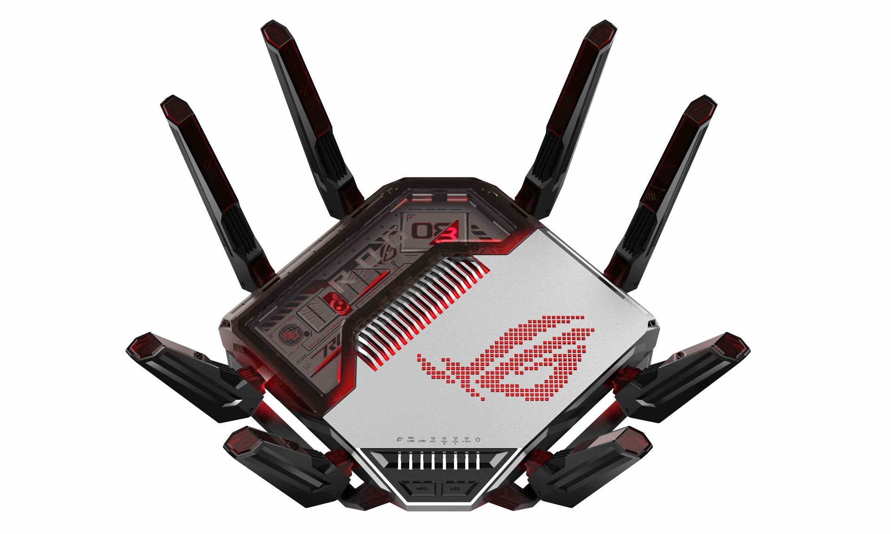
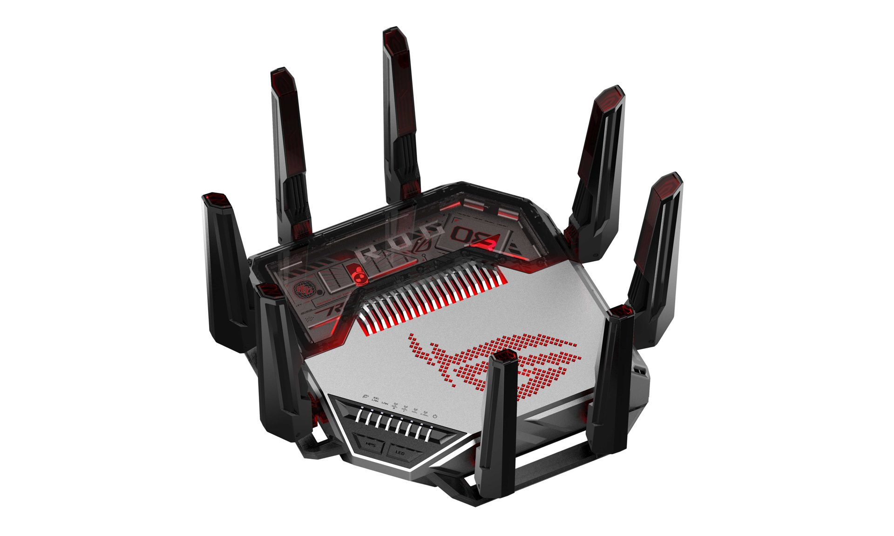
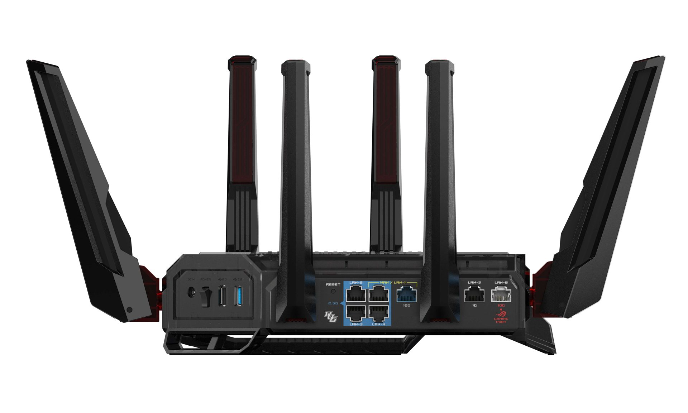

(11 月 3 日，台北訊) 華碩旗下電競領導品牌 ROG 玩家共和國，今宣布由次世代 WiFi 8 驅動的 [ROG Rapture GT-BN98](https://rog.asus.com/tw/networking/rog-rapture-gt-bn98/) 電競路由器，正式在台上市！將透過最新 WiFi 8 技術、智慧頻寬最佳化及強化的網路可視性，帶來超高穩定性與極致連線效能，無論是智慧家庭等多裝置充斥的環境，或處於重度負載狀態下，都能確保每次操作精準到位，招招爆擊！即日起至 11 月 30 日以前購買並至官網登錄，再送 ROG 20 週年限量保溫杯、ROG OMNI 絨毛公仔 (數量有限，贈完為止)。

_華碩旗下電競領導品牌ROG玩家共和國，今宣布由次世代WiFi 8驅動的ROG Rapture GT-BN98電競路由器，正式在台上市。_

_透過最新WiFi 8技術、智慧頻寬最佳化及強化的網路可視性，帶來超高穩定性與極致連線效能，無論是智慧家庭等多裝置充斥的環境，或處於重度負載狀態下，都能確保每次操作精準到位，招招爆擊！_

## 穩若磐石的 WiFi 8 連線

ROG Rapture GT-BN98 除具備高達 25,000Mbps 的驚人頻寬，亦搭載全新 MCS 速率、UEQM 及 NPCA 等先進技術，可大幅提升傳輸量與覆蓋範圍；同時，與過去追求峰值速度的 WiFi 世代不同，WiFi 8 優先考量不同訊號條件下的效能一致性，以減少瞬時速度驟降，打造更快且可靠無虞的全屋連線，時時刻刻火力全開！

## 動態 QoS：智慧調度 游刃有餘！

全新 ROG Rapture GT-BN98 內建動態 QoS (Adaptive Quality of Experience)，能根據即時網路狀況與應用程式需求，智慧分配頻寬，不僅遊戲反應靈敏，戰術指令零延遲，串流與下載也能持續進行，不受干擾，一心多用依然表現出色。

## 洞燭機先 運籌帷幄— WiFi Insight

此外，使用者還可藉由獨家 WiFi Insight 功能實現全頻譜分析、即時頻道切換及 24 小時事件追蹤，深入洞察通常難以偵測的隱藏干擾源，自動偵測與最佳化，搭配視覺化的網路健康報告，輕鬆識別、解決問題，告別網路卡頓惡夢。

## GTNet：決勝千里 戰無不勝！

有別於傳統路由只選擇最短路徑，整合於網頁介面的第三方服務 GTNet，可智慧評估延遲與擁塞狀況，找出最快路徑，增進連線品質，助攻玩家取得更多勝利優勢，贏在起跑點，稱霸遊戲世界！

## 固若金湯的有線傳輸

隨著網速與裝置需求漸增，高速有線傳輸變得至關重要，ROG Rapture GT-BN98 配備兩個 10G 與四個 2.5G 連接埠，以支援進階網路配置及頻寬密集型應用，包括：電競主機、NAS 儲存或多媒體伺服器，將為現代網路架構帶來極富彈性和隨時就緒的穩固效能。

_ROG Rapture GT-BN98配備兩個10G與四個2.5G連接埠，以支援進階網路配置及頻寬密集型應用，包括：電競主機、NAS儲存或多媒體伺服器，將為現代網路架構帶來極富彈性和隨時就緒的穩固效能。_

## 滴水不漏的資安防護— ASUS AiProtection

全新 ROG Rapture GT-BN98AiProtection 另內建進階版全時安全防護，具備廣告/追蹤器阻擋、惡意網站過濾及受感染裝置阻擋等功能，可為所有連線裝置提供持續、即時防禦，讓玩家更全神貫注於分秒必爭的驚險沙場，無後顧之憂！

**ROG Rapture GT-BN98 電競路由器，建議售價： NT$ 27,990**
