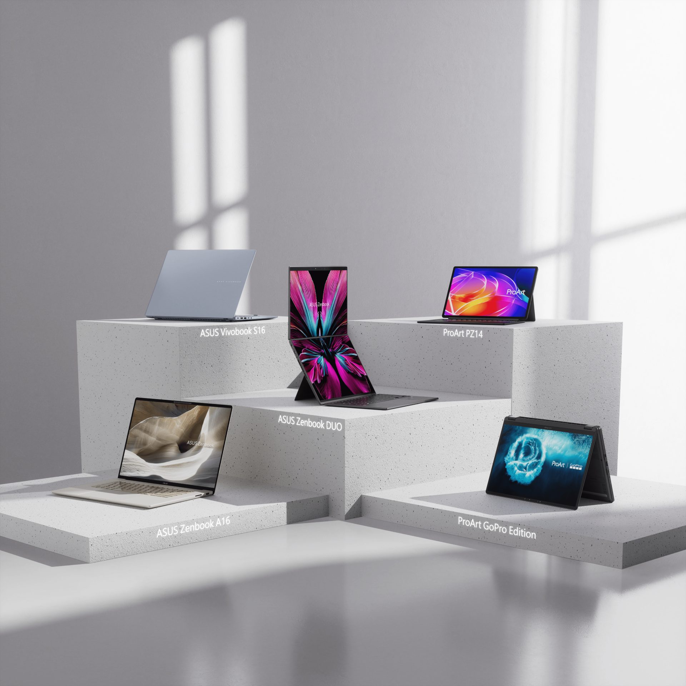

**掌握在地需求、深化製造與通路布局，展現華碩深耕拉丁美洲市場的品牌實力**

（11 月 10 日，巴西訊）華碩今日宣布，根據 2026 年 9 月最新權威市場研究數據調查，從年初截至 9 月華碩市占率達 23.3%，榮登巴西消費型筆記型電腦市場第一品牌。不僅彰顯華碩深耕巴西市場的長期承諾，更展現在拉丁美洲重要 PC 市場的競爭實力。這項成果奠基於三大關鍵優勢：深入洞察巴西消費者需求、因應當地需求的在地製造布局，以及與巴西主要零售及電子商務通路的穩固合作夥伴關係。

_華碩今日宣布，根據2026年9月最新權威市場研究數據調查，從年初截至9月華碩市占率達23.3%，榮登巴西消費型筆記型電腦市場第一品牌。_

華碩深耕巴西市場，持續洞察當地消費者在學習、工作、創作及娛樂等多元情境下的需求，積極導入最新技術與產品，讓巴西消費者能即時體驗創新科技。憑藉完整的產品布局，華碩提供滿足不同預算與使用需求的筆記型電腦，包括以可靠性滿足學生及家庭日常需求的 Vivobook 系列、兼具優雅與持久效能的高階 Zenbook 系列，以及為專業創作者打造、提供強大效能與精準度的 ProArt 系列；此外，ROG 與 TUF Gaming 電競筆記型電腦則以頂尖效能遊戲體驗，滿足巴西玩家的多元需求。

巴西是華碩重點投資市場之一，透過當地子公司的營運與製造布局，華碩已在巴西生產多款筆記型電腦，自 2024 年起在地製造已涵蓋完整的電競筆記型電腦產品陣容，以提升市場應變能力，快速回應當地消費者需求。此外，華碩持續強化與巴西主要零售及電子商務通路的合作關係，在各大通路占據領先地位，透過完善的線上與實體銷售，讓全巴西消費者都能輕鬆地選購華碩產品。

展望未來，華碩將持續深耕巴西市場，包括在地製造布局、導入創新產品，以及攜手當地合作夥伴拓展市場版圖，希望進一步穩固市場領導地位，持續成為巴西消費者的首選品牌。
