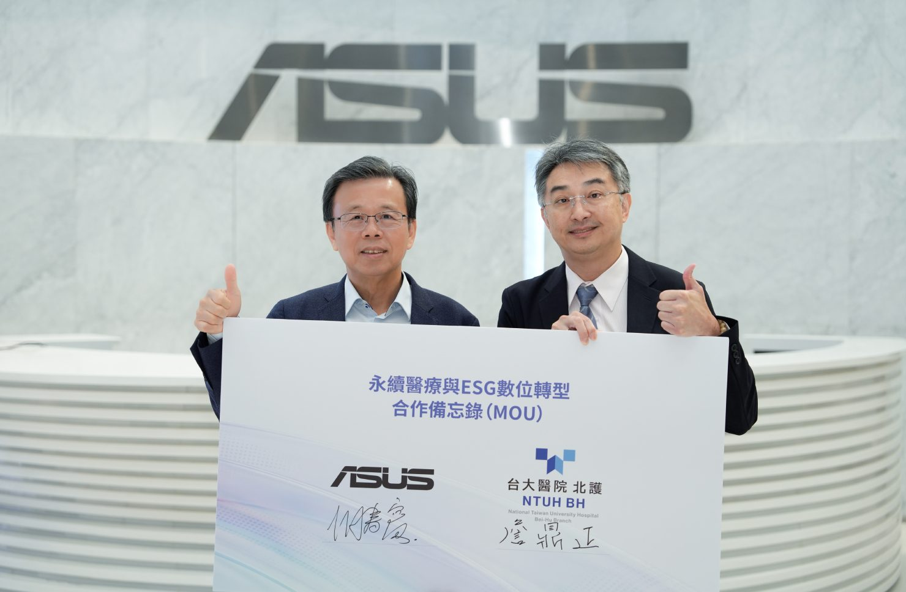

(11 月 10 日，台北訊) 華碩宣布與臺大醫院北護分院 簽署「永續醫療與 ESG 數位轉型合作備忘錄（MOU）」，首次以技術顧問角色協助醫療院所建立醫療服務碳足跡，並結合華碩碳數據管理平台、AI 應用與永續管理實務經驗，協助院方深化碳管理並強化減碳決策，推動低碳醫療發展。

_華碩宣布與臺大醫院北護分院 簽署「永續醫療與ESG數位轉型合作備忘錄（MOU）」(左為華碩共同執行長胡書賓，右為臺大醫院北護分院院長詹鼎正)_

華碩共同執行長胡書賓表示：「華碩持續推動永續與數位雙軸轉型，將科技創新與永續實踐從自身營運及供應鏈，延伸至不同產業。此次與臺大醫院北護分院合作，華碩首度以技術顧問角色，將產品碳足跡實務經驗，結合 AI 與碳數據管理平台，協助院方提升碳管理效率，建立醫療服務碳足跡，加速醫療永續轉型。」

臺大醫院北護分院院長詹鼎正表示：「北護分院以 2050 淨零排放為目標，持續推動溫室氣體盤查與院內減碳行動。期望透過此次合作，提升資料追溯與管理效率，並配合深耕計畫，逐步建立服務碳足跡，將減碳思維融入醫療服務與營運決策，兼顧優質照護與環境永續。」

本次合作以北護分院導入數位化管理為起點，透過平台及 AI 應用，協助提升碳數據整合及管理效率，並為院方後續碳減量管理建立資料基礎。在華碩碳數據管理平台服務之外，華碩進一步發揮跨產業技術與實務經驗，協助建置醫療服務碳足跡，將首款商用筆電通過產品碳足跡第三方認證的實務經驗，轉化為可拓展至不同產業的專業顧問服務。

展望未來，華碩將持續深化科技創新與永續管理，攜手醫療院所探索可複製、可擴展的低碳醫療模式，為台灣醫療體系的淨零轉型與永續韌性創造長期價值。
