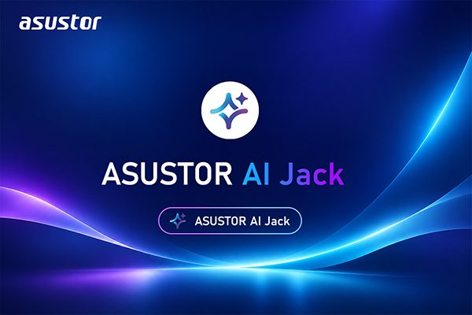

**AI服務再升級，協助用戶快速掌握產品規格、選購建議與操作指引。**

**台灣，台北，2026 年 11 月 10 日** – 智慧儲存解決方案領導品牌 ASUSTOR Inc. 今日宣布，於官方網站推出全新互動服務「AI Jack」Beta 試用版，Jack 是我們虛擬客服的代稱。他使用 AI 大型語言模型與專屬 ASUSTOR NAS 產品知識庫，協助使用者即時查詢產品規格、了解不同系列差異、探索個人雲端應用，並取得設定與故障排除指引。透過直覺的自然語言互動，無須熟悉複雜的專業術語，也無須與專業人士或客服對談即可有效率地尋找所需資訊，大幅降低 NAS 選購與使用的學習門檻。

_ASUSTOR AI Jack 主視覺圖_

## 掌握 AI Jack 四大核心特色

隨著個人與企業對資料備份、檔案共享及私有雲應用的需求持續增加，如何選擇適合的 NAS 型號、了解硬體規格與完成系統設定，成為用戶在導入 NAS 時的重要課題。AI Jack 透過智慧問答，提供以下四大核心功能：

### 1. AI 輔助選購建議

使用者可直接描述應用情境、預算與使用需求，例如 4K 影音備份、家庭檔案管理或小型企業資料備份。AI Jack 可依據最新產品資訊，協助使用者了解適合的 NAS 機型、硬體規格與應用方向，做出更合適的選擇。

### 2. 產品規格與相容性查詢

從網路連接埠、記憶體規格到硬碟支援情況，使用者可透過自然語言查詢相關產品資訊，並進一步了解硬碟、SSD、記憶體等周邊設備的相容性。透過更直覺的資訊檢索方式，無須逐一翻閱大量技術文件，即可更有效率地找到所需資料。

### 3. NAS 設定與故障排除指引\*

針對儲存空間與 RAID 規劃、ADM 系統操作、資料備份、快照及遠端連線等常見問題，AI Jack 能提供相關操作說明與疑難雜症排除步驟，快速理解設定流程，並更有效率地協助用戶快速解決技術相關問題。

### 4. 全天候 AI 問答與多語言互動

AI Jack 支援多國語言及 24 小時全天候 AI 問答服務，可隨時查詢產品與技術資訊。透過自然語言互動，並依照自己的需求提出問題，深度探索 ASUSTOR NAS 的多元功能與應用場景。（實際語言支援範圍依官方網站即時提供為準）

## 持續優化 AI 互動體驗

AI Jack 即日起於 ASUSTOR 官方網站開放使用。ASUSTOR 未來也將持續探索 AI 技術在儲存領域的各項應用與發展可能性，協助家庭、影音創作及企業用戶更有效率地運用 NAS，進一步發揮資料儲存、備份與管理的最大價值。

AI Jack 的回答旨在提供參考與輔助，不保證所有資訊或操作指引均完全正確。實際操作方式與功能支援情況，仍應以對應機型及 ADM 版本的官方文件為準。

【立即體驗 AI Jack】ASUSTOR 官方網站：[https://www.asustor.com](https://www.asustor.com/)

## 關於 ASUSTOR Inc.

華芸科技 (ASUSTOR Inc.) 正式成立於 2011 年 8 月，是由華碩電腦 (ASUSTeK Computer Inc.) 所直接投資成立的公司，以 ASUS Storage 為意，建立自有品牌 ASUSTOR，專注於網路儲存裝置 (NAS) 的設計及相關韌、硬體及應用程式的研發及整合，致力於提供穩定、高品質及服務至上的優質網路儲存解決方案。
