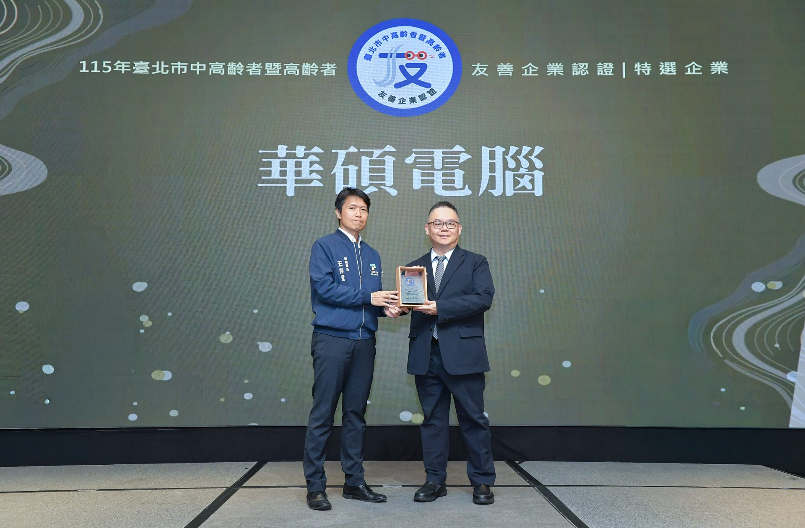

（11 月 16 日，台北訊）面對超高齡社會趨勢，華碩秉持以人為本的理念，打造全齡共融的友善職場，榮獲「115 年度臺北市中高齡者暨高齡者友善企業認證」肯定。華碩透過多元職涯發展、彈性工作及員工照護措施，支持中高齡人才發揮專業價值，促進跨世代交流與經驗傳承。

_華碩榮獲「115年度臺北市中高齡者暨高齡者友善企業認證」肯定。(左為臺北市政府副秘書長王崇斌，右為華碩人資長廖致凱)_

在人才培育方面，華碩落實不分年齡的平等任用原則，提供內部轉調及彈性留任機制，鼓勵資深人才持續貢獻專業。透過內部培訓，更培育超過 330 位內部講師，促進跨部門交流及知識傳承；同時推動「Better Conversation Everyday」溝通計畫，強化跨世代的理解與合作。

此外，華碩提供彈性工作、健康照護及員工協助方案，支持中高齡同仁兼顧職涯發展與家庭需求，讓資深的寶貴經驗成為企業成長的動力。
