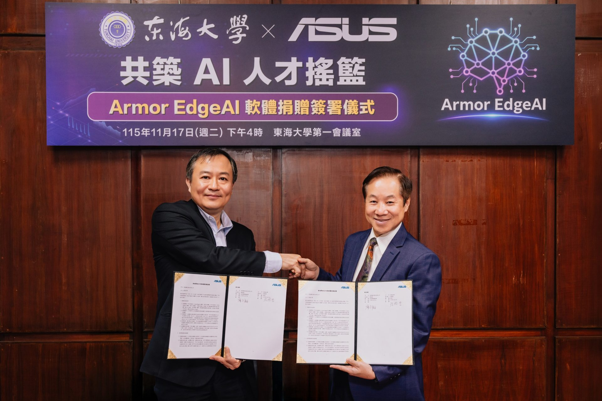
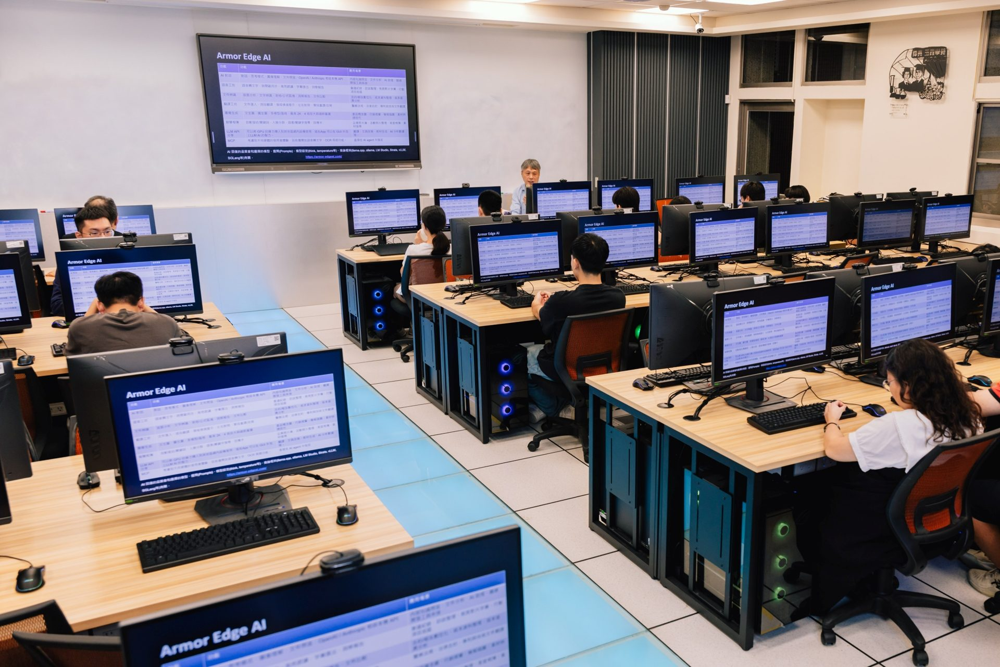
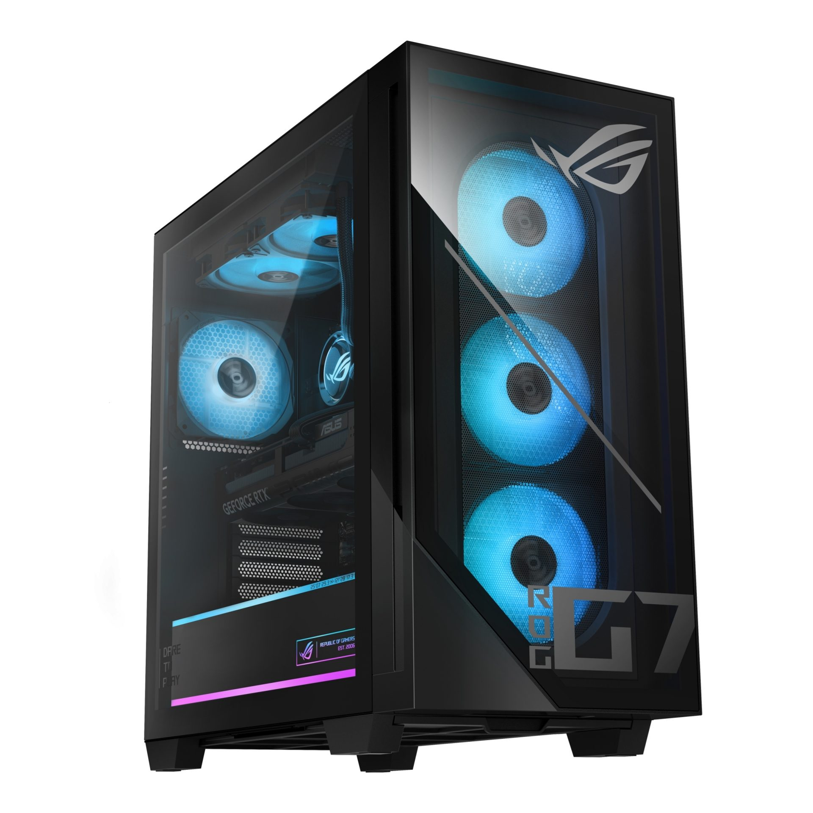

**實現Token自由、守資料安全、強化AI實作 六大應用助攻跨域學習**

（11 月 18 日，台北訊）迎接代理式 AI 浪潮，華碩深化 AI 智慧教育布局，捐贈 66 套地端 AI 軟體 [Armor EdgeAI](https://www.asus.com/tw/events/infoM/activity_armoredgeai)，導入以 [ROG GM700](https://rog.asus.com/tw/desktops/full-tower/rog-g700-2025-g700/)[電競桌機](https://rog.asus.com/tw/desktops-group/)[AI PC](https://www.asus.com/tw/content/asus-ai-pc/) 教室，協助東海大學打造地端 AI 實作基地。結合強大硬體算力與地端 AI 應用，讓師生可於本機直接操作 AI 模型、串接 AI Agent；教學與研究資料無須上傳雲端，亦可降低 AI 服務訂閱與 Token 使用成本，兼顧資訊安全與運算效率，協助學子累積實務經驗，接軌未來產業需求。

_華碩深化AI智慧教育布局，捐贈66套地端AI軟體Armor EdgeAI，導入以ROG GM700電競桌機建置的AI PC教室，協助東海大學打造地端AI實作基地。_

華碩聯合科技系統事業總經理廖逸翔表示，AI 正快速從對話、工具應用走向 AI Agent，新世代人才需要具備的，也不只是「會用 AI」，而是進一步理解 AI、駕馭 AI，甚至創造 AI。華碩長期深耕教育市場，希望透過 Armor EdgeAI 自主、安全、靈活的地端 AI 環境，讓師生能放心探索、大膽實驗，將想法快速化為實際應用。此次透過軟硬體整合，華碩期盼與東海大學共同打造更貼近產業未來的 AI 實作環境，讓創新從校園萌芽，培育下一世代 AI 人才。

東海大學校長張國恩表示，東海與華碩合作多年，從早期 AI NB 到 AI PC 教室的建置，華碩都是重要的合作夥伴。目前東海已建置 7 間 AI 教室及 B200 算力中心，其中 5 間為華碩 AI PC 教室，此次再導入 Armor EdgeAI 軟體，將進一步完善師生的 AI 教學與實作環境。目前臺中市政府已有多項員工教育訓練於東海辦理，未來也歡迎尚未建置 AI 環境的各級學校及政府機關到東海共享資源，期待透過雙方持續擴大合作，共同推動 AI 在大學及中小學教育的應用與革新。

## Armor EdgeAI 六大智慧應用 拓展跨域學習新可能

Armor EdgeAI 整合本機 AI 對話、OCR 文件辨識、語音轉錄、文件翻譯、圖像生成及相簿智慧搜尋等六大功能，滿足校園多樣的教學與研究型態。不論是程式編寫、文獻整理、訪談紀錄到視覺素材製作，皆能靈活運用，讓師生將課堂知識延伸至實際操作，為跨域學習拓展無限可能。

_Armor EdgeAI整合本機AI對話、OCR文件辨識、語音轉錄、文件翻譯、圖像生成及相簿智慧搜尋等六大功能，滿足校園多樣的教學與研究型態。_

相較於仰賴雲端運算的 AI 服務，Armor EdgeAI 可直接運用本機 GPU 算力執行模型推論，省去額外訂閱 AI 服務及雲端 Token 使用成本，教學資料與研究成果亦可保留於本機，避免機敏資訊外流風險。透過 API 串接及算力分享功能，並支援不同模型、外部工具與 AI Agent 整合，讓學生從單純使用 AI 工具，到進一步探索模型部署、工具串接與多步驟工作流程設計，深化技術理解與實務能力。

## ROG GＭ700 強悍效能助陣 建構 AI 創新教學基地

東海大學 AI PC 教室配置 ROG GＭ700 電競桌機，最高搭載 AMD Ryzen™ 9 9950X3D 處理器與 NVIDIA® GeForce RTX™ 5080 顯示卡，具備完善散熱設計，可流暢運行高負載教學與研究；最高支援 64GB DDR5 記憶體及 2TB 固態硬碟，加速資料存取與多工作業。58L 大容量機身採用免工具快拆設計，搭配防塵濾網與標準化零組件，兼顧維護便利性及升級彈性。華碩亦可依校園教學與設備需求，提供客製化規格配置，協助校方打造符合實際應用的運算環境。未來華碩也將持續深化產學合作，以軟硬體整合優勢打造接軌產業需求的 AI 實作據點，為新世代 AI 教育樹立標竿。

_ROG GM700電競桌機。_

- 長官合照：(左起)華碩聯合科技系統事業總經理廖逸翔、東海大學校長張國恩
