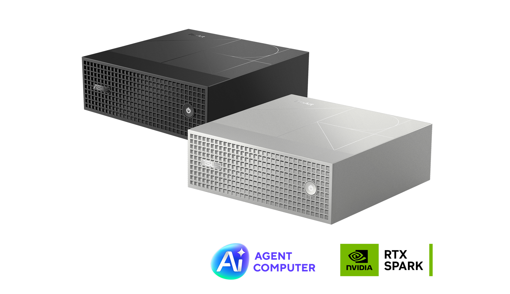
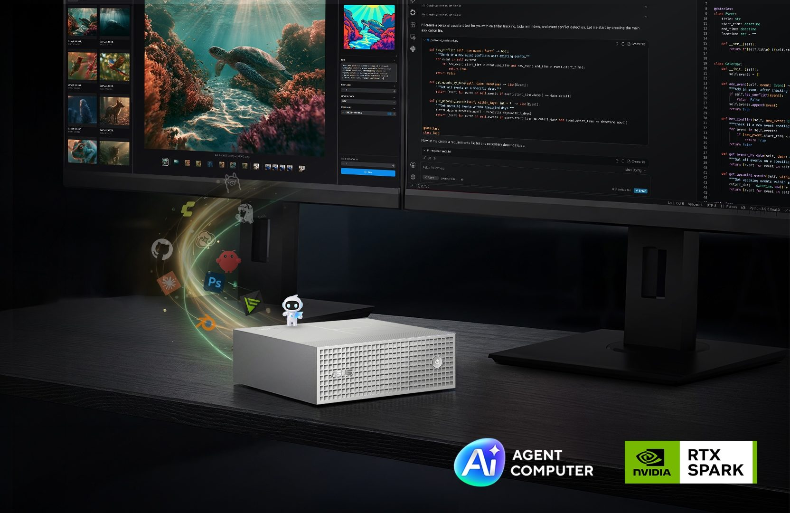
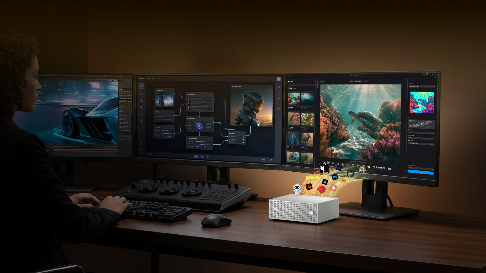

(11 月 19 日，台北訊) 華碩今宣布於 IFA 2026 正式登台的 [ProArt GR1X](https://www.asus.com/tw/displays-desktops/mini-pcs/proart-mini-pc-series/proart-gr1x-mini-pc/) 代理人電腦(Agent Computer)在台上市！其搭載 NVIDIA 集數十年大成於一身的 RTX Spark 超級晶片，結合 Blackwell 世代的 RTX GPU、NVIDIA Grace CPU、支援 FP4 的第五代 Tensor 核心，以及 NVIDIA NVLink-C2C 互連技術，再加上與 NVIDIA CUDA、新一代 Windows PC 的高度相容性和華碩獨家應用解決方案，讓本機 AI 更易於部署、個人化與使用，成就無與倫比的創作體驗。

_華碩今宣布於IFA 2026正式登台的ProArt GR1X代理人電腦(Agent Computer)在台上市！_

_ProArt GR1X搭載NVIDIA RTX Spark超級晶片，結合Blackwell世代的RTX GPU、NVIDIA Grace CPU、支援FP4的第五代Tensor核心，以及NVIDIA NVLink-C2C互連技術，再加上與NVIDIA CUDA高度相容性，讓本機AI更易於部署、個人化與使用，成就無與倫比的創作體驗。_

近來，AI 已演進到能自主執行任務的「AI Agent」階段，用戶關注焦點除了運算效能，更重視資訊安全、長期推論費用，以及硬體配置能否針對不同需求和預算客製化，因此涵蓋迷你超級電腦、DIY PC 及專業工作站在內等[代理人電腦](https://www.asus.com/microsite/agent-computer/tw/)解決方案也應運而生！透過其進行地端建置，將能自主掌握機密文件，大幅降低外洩風險，並有效節省雲端 API Token 開銷，最佳化整體持有成本(TCO)，坐享 24/7 全時自動化代理、極速工作流程與 AI 代理群體(Agent Swarms)量身訂製的硬體生態系，加速百工百業數位轉型！

全新 ProArt GR1X 迷你超級電腦，除配備高達 1 PFLOP FP4 的 AI 算力、128GB 統一記憶體，亦藉由 Nous Research 開發的開源代理平台 Hermes，串聯自然語言互動的開源節點架構繪圖介面 ComfyUI，和自有生成式 AI 應用程式 MuseTree，能直接於本機執行更大規模的 AI 模型、實現更快速的 3D 渲染，為創作者及開發者開啟無限可能嶄新篇章。

專為執行全時本機 AI 運算的創作者、SOHO 族、中小型企業、教育與醫療單位等各類組織而生的 ProArt GR1X，僅 150 x 150 x 51 mm 的精巧機身內建頂尖雙風扇散熱系統，確保在工作室、開發環境與共享工作空間中皆能持續穩定運作；同時，還採用雙 M.2 SSD 儲存、10GbE 網路、WiFi 7、Bluetooth 5.4，並可外接至多四台 4K 螢幕，以打造多功能地端 AI 中樞，非常適合代理、模型服務、生成與創意工作流程自動化等應用場域。

_全新ProArt GR1X迷你超級電腦採用雙M.2 SSD儲存、10GbE網路、WiFi 7、Bluetooth 5.4，並可外接至多四台4K螢幕，以打造多功能地端AI中樞，非常適合代理、模型服務、生成與創意工作流程自動化等應用場域。_

ProArt GR1X 不僅擁有強大算力，另支援包括 Adobe Premiere 在內等軟體服務及工具，能賦予創作者在本地與雲端之間切換的高度彈性，兼顧效能、隱私與多元創意需求；此外，表裡如一的 ProArt GR1X，在外觀設計方面亦毫不妥協，具備黑、銀兩款全新配色，分別展現洗練的陽極氧化質感，以及絲滑細緻的噴砂工藝，無論置於何處都能完美融入，更顯俐落專業。

**ProArt GR1X 代理人電腦，建議售價： NT$ 169,000 起**；即日起於全台通路購買並完成登錄，再送《Claude 完全手冊：零基礎打造你的 AI Agent》線上課程開通序號！（數量有限，贈完為⽌）
