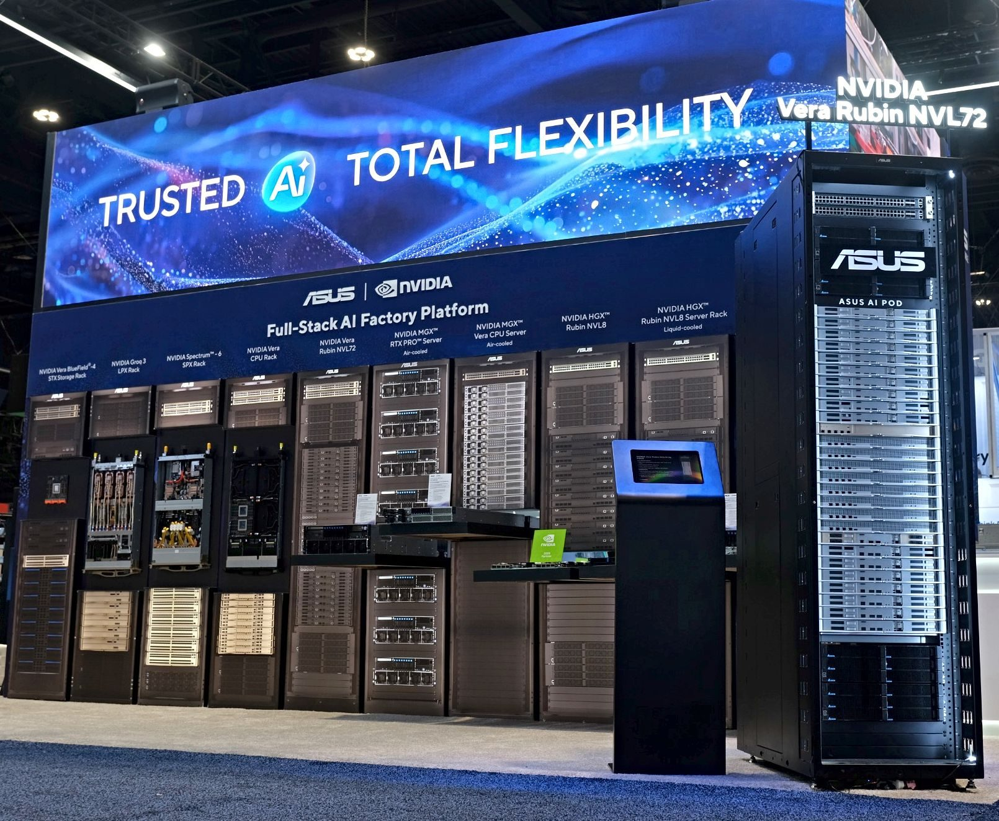
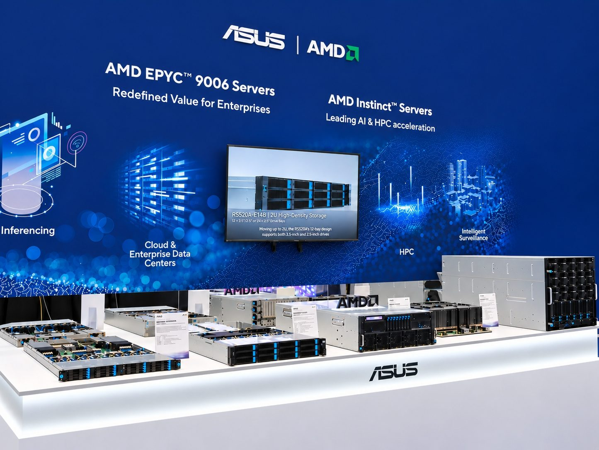
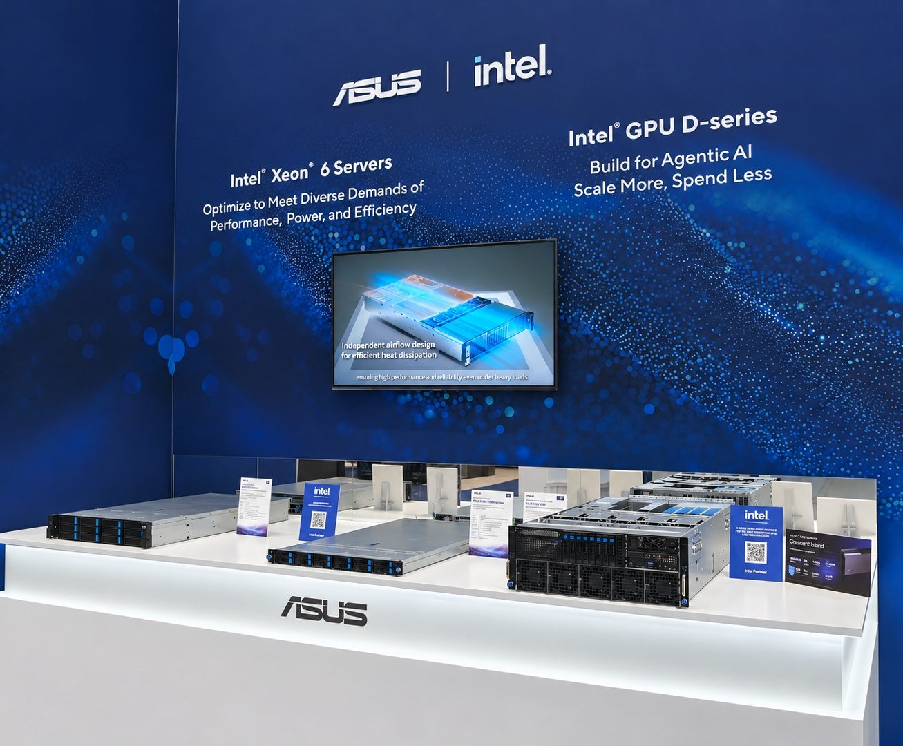

**全方位 AI 工廠示範架構亮相 SC26---實現即戰部署 加速落地應用**

(11 月 20 日，台北訊) 受惠市場強勁需求，華碩宣布第四季擴大 NVIDIA Vera Rubin NVL72 系統出貨規模，全力搶攻大廠訂單，為營運挹注成長動能；並於日前全球高效能運算年度盛會 SuperComputing 2026 (SC26)，展示全方位 AI 工廠示範架構，結合 L10 / L11 自動化製造、早期工程風險評估與六層機架級驗證，打造涵蓋設施規劃、軟硬體基礎架構、自動化部署至持續營運的完整建置流程，將繁瑣架構轉化為經過實測、開箱即用的解決方案，協助企業加速實現大規模 AI 部署。

_受惠市場強勁需求，華碩宣布第四季擴大NVIDIA Vera Rubin NVL72系統出貨規模，全力搶攻大廠訂單，為營運挹注成長動能。_

本次參展產品陣容堅強，涵蓋[全液冷](https://www.asus.com/event/server-liquid-cooling-solution/)機架級架構的 [ASUS AI POD XA VR721-E3](https://www.asus.com/event/asus-ai-pod-nvidia-vera-rubin-nvl72/)，搭載 72 顆 NVIDIA Rubin GPU 與 36 顆 NVIDIA Vera CPU，可輕鬆應對前沿模型訓練、複雜推理及高吞吐量推論等嚴苛所需；還有 NVIDIA Groq 3 LPX、Vera CPU 運算托盤、Spectrum-X SN6600 乙太網路交換器，以及 STX-CMX；整合運算、網路與情境記憶體(context memory)，可支援高強度 AI 工作負載，大幅提升工廠生產力。

此外，華碩亦同步展示兩款搭載 NVIDIA HGX Rubin NVL8 的系統平台，包括：採用混合散熱設計的 [XR R1I12B-M1BHFS](https://www.asus.com/) (3U)與全液冷 [XR R1I12B-M1BLFS](https://servers.asus.com/products/servers/gpu-servers/XR-R1I12B-M1BLFS) (2U)；至於 NVIDIA MGX 系列，則有內建 NVIDIA Vera CPU、支援 AMD Instinct™ MI350P，為專業加速運算而生的 [ESC8000A-E13P](https://servers.asus.com/products/servers/gpu-servers/ESC8000A-E13P)，非常適合需要高度運算力的模型開發與科學模擬等相關應用。

_本次參展亦同步發表AMD EPYC™ 9006 系列伺服器和 AMD Instinct™ 加速平台，產品陣容涵蓋人工智慧推理、雲端和企業數據中心、高性能計算和智慧監控。_

## 可擴充 AI 工作負載的資料基礎架構

而對於 AI 工廠運作同樣至關重要的資料儲存及傳輸，華碩也發表多款相應產品，如 VS320D-RS26N 企業級儲存平台、[OJ340A-RS60 高密度物件儲存系統](https://servers.asus.com/products/storage/object-storage/OJ340A-RS60)，以及搭載[第 6 代 AMD EPYC 9006](https://www.asus.com/event/amd-epyc-9006-servers/) 處理器、支援 PCIe 6.0 連接技術與 NVMe 儲存的 1U 伺服器 RS500A-E14B-R12U，確保企業拓展 AI 場域時，兼顧儲存容量、資料存取及運算資源配置；同時，還有即將推出的 ESC8000-E13P，配備代號 Intel Crescent Island 的 Intel® GPU D-series 加速器和代號為 Diamond Rapids 的 Intel 次世代伺服器處理器，將為正在評估 AI 運算策略的企業帶來更多選擇。

_華碩於日前全球高效能運算年度盛會SuperComputing 2026 (SC26)展示即將推出的ESC8000-E13P，配備代號Intel Crescent Island的Intel® GPU D-series加速器和代號為Diamond Rapids的Intel次世代伺服器處理器，將為正在評估AI運算策略的企業帶來更多選擇。_

## 從設計、部署到持續營運與管理

為協助企業妥善建置 AI 工廠，華碩運用自身系統工程專業技術、[ASUS AI 工廠解決方案](https://www.asus.com/event/asus-ai-factory/)、NVIDIA DSX 參考設計，以及 NVIDIA DSX Sim 旗下的 [NVIDIA Omniverse DSX Blueprint for AI Factory Digital Twins (AI 工廠數位雙生藍圖)](https://blogs.nvidia.com/blog/omniverse-dsx-blueprint/)，並與 Schneider Electric、AVEVA 及 IBM 等生態系合作夥伴合作，在實際部署前模擬設施需求與系統配置，以提早發現潛在限制，針對不同方案分析取捨，減少代價高昂的現場變更。

此外，用戶亦可透過 ASUS Professional Services 評估場地就緒狀況，規劃電力與冷卻基礎設施、整合系統，協調現場安裝作業；搭配 [ASUS Infrastructure Deployment Center (AIDC)](https://www.asus.com/event/asus-infrastructure-deployment-center/) 自動執行系統佈建、叢集設定及軟體安裝，將通過驗證的硬體轉化為可投入服務的基礎架構；完成部署後，還能藉由 ASUS Control Center (ACC) 集中監控、資安管理與更新管理等功能，從設計階段推進至正式營運，皆保有足夠的擴充能力，因應持續成長的 AI 工作負載。

## 延伸至邊緣端的智慧運算

AI 價值多體現於資料產生現場，華碩 [PE3000N](https://www.asus.com/networking-iot-servers/aiot-industrial-solutions/embedded-computers-edge-ai-systems/pe3000n/) 與 [PE6000G](https://www.asus.com/networking-iot-servers/aiot-industrial-solutions/embedded-computers-edge-ai-systems/pe6000g/) 系統，將智慧運算從資料中心延伸至邊緣端，以滿足機器人、工業自動化或需要快速回應的現場資料處理應用；桌邊運算方面，ASUS Ascent GX10 及 [ExpertCenter Pro ET900N G3](https://www.asus.com/displays-desktops/workstations/performance/expertcenter-pro-et900n-g3/)，可提供開發人員與企業團隊極為出色的加速算力，在本地端進行原型開發、最佳化和執行，再擴展至更大型的基礎架構，成為數位轉型之路上深得信賴的最佳拍檔。
