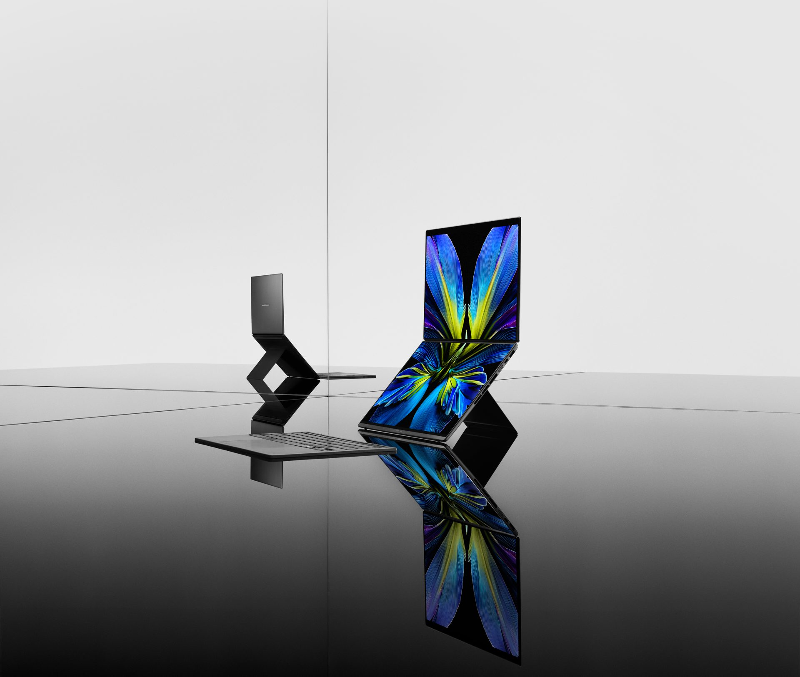

( 11 月 20 日，台北訊 ) 華碩 Zenbook DUO (2026) (UX8407) 雙螢幕 AI 筆記型電腦，榮獲《TIME》雜誌「2026 年度最佳發明 (Best Innovations of 2026)」肯定；該榜單每年由專業編輯團隊遴選 300 項讓世界「更美好、更智慧、更有趣」的創新發明，被視為全球最具指標性的創新評選之一。繼奪下 2026 年 iF 金獎、美國傑出工業設計獎及日本 Good Design Award 多項國際設計大獎後，Zenbook DUO 再獲《TIME》青睞，充分展現其卓越的創新設計實力。

_華碩 Zenbook DUO 榮獲《TIME》雜誌 2026 年度最佳發明_

Zenbook DUO 以創新的雙螢幕設計，將兩塊採用防眩光塗層的 14 吋 3K ASUS Lumina Pro OLED 觸控螢幕無縫整合至 Copilot+ PC 的纖薄機身中，打造靈活高效的行動工作空間。取下磁吸式藍牙鍵盤後，即可啟用雙螢幕模式，讓使用者同時開啟多個應用程式、比對文件或檢視參考資料；內建整合式支架則支援直式或橫式擺放，無論桌面工作、會議簡報或內容創作，皆能彈性運用。

《TIME》特別肯定 Zenbook DUO 在機構工程上的突破。產品透過零組件的精密配置與平衡，確保系統在任何操作模式下皆能穩定運作。全新隱藏式螢幕轉軸設計，進一步將雙螢幕間隙較前一代縮減 70%，帶來更連貫沉浸的視覺體驗；而鍵盤則藉由磁性彈簧針腳穩固收合於兩片螢幕之間，兼顧便利性與攜帶性。

軟體方面，ASUS ScreenXpert 可協助使用者於雙螢幕間順暢移動應用程式視窗，打造更直覺的工作流程；當螢幕展開角度超過 175° 時，系統會自動顯示快速分享與註記工具選單，強化簡報與協作效率；靈活的雙螢幕配置，讓使用者無須額外連接外接顯示器，即可輕鬆擴展工作空間，提升多工生產力。

Zenbook DUO 採用華碩獨家高科技陶瓷鋁合金 (Ceraluminum™) 機身，體積較前一代縮小 5%，搭配 MagLatch™ 鍵盤磁吸式設計，兼具精巧質感與便攜性。配備 99Wh 雙電池系統，並最高搭載 Intel® Core™ Ultra X9 系列 3 處理器，為專業與創作工作提供強勁效能與長效續航。雙 3K Lumina Pro OLED 觸控螢幕支援 144Hz 更新率，結合高色準顯示與最高可達 1,000 尼特峰值亮度，呈現流暢且色彩鮮明的視覺效果。
