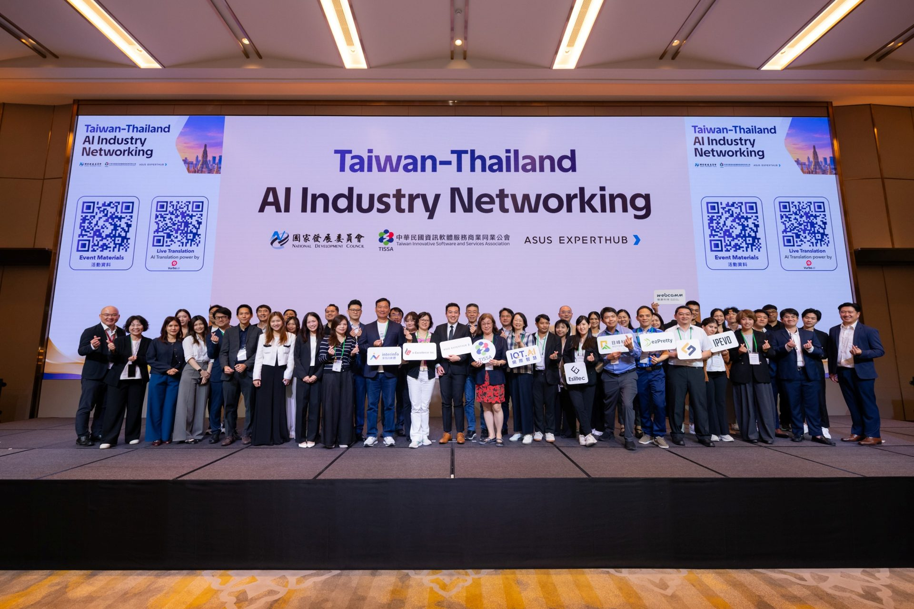
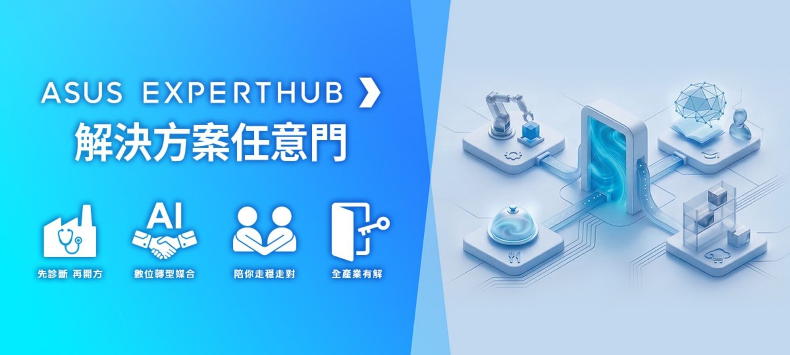

**響應國發會AI軟硬共融計畫 華碩共好生態圈跨出關鍵下一步**

（11 月 23 日，台北訊）華碩持續深化商用市場布局，[ASUS EXPERTHUB 解決方案任意門](https://experthub.asus.com/)響應國家發展委員會「AI 軟硬共融整合輸出計畫」，攜手中華民國資訊軟體服務商業同業公會，串聯多家台灣優質軟體服務業者（ISV）前進泰國，參與臺泰 AI 產業交流媒合會，對接當地企業、系統整合商與經銷夥伴，讓台灣 [AI 數位轉型](https://experthub.asus.com/about)解決方案被世界看見！華碩結合長年商用市場經驗、海外布局與在地通路資源，協助台灣軟體業者洞悉泰國市場需求，尋求潛在合作機會、開拓商機，讓 ASUS EXPERTHUB 共好生態圈從台灣擴展至海外市場。

_ASUS EXPERTHUB解決方案任意門響應國家發展委員會「AI軟硬共融整合輸出計畫」，攜手中華民國資訊軟體服務商業同業公會，串聯多家台灣優質軟體服務業者前進泰國，參與臺泰AI產業交流媒合會。_

## ISV 集結出海 軟硬整合搶攻泰國 AI 商機

本次集結偉康科技、以力、愛比科技、預約科技行銷、思銳智慧科技、網際智慧、日峰科技、英特內軟體及一等一科技等 ISV 夥伴，聚焦製造、零售、教育及企業管理等多元領域。從設備監控、顧客經營到資安防護與 AI 協作，以專業軟體服務搭配華碩穩定可靠的商用設備與平台資源，幫助企業提升工作效率、優化管理流程，讓創新技術轉化為實際營運價值。

以泰國作為 ASUS EXPERTHUB 國際拓展的重要起點，華碩發揮全球商用市場經驗，協助台灣 ISV 夥伴更直接掌握企業需求，降低跨境市場開發門檻。此次參與媒合的企業橫跨 15 類產業，以金融、醫療、資訊科技及製造業居多，尤其對 AI 應用、企業流程自動化及業務行銷工具展現高度興趣，反映當地企業對提升營運效率、優化工作流程與拓展業務的重視。藉由面對面的商務交流與媒合，不僅讓業者驗證解決方案的市場空間，也為後續洽談、方案導入與長期合作建立基礎。未來華碩亦將持續與國發會、軟體公會攜手並進，鏈結起政府、公協會、軟體業者、國際產業夥伴與通路資源，把台灣 AI 軟硬整合實力推向世界，為全球企業 AI 數位轉型注入新動能。

## 百項解方精準媒合 打造商用解決方案共好生態圈

ASUS EXPERTHUB 以企業真實需求為核心，匯聚超過百項軟硬體、雲端服務、AI 應用及資安解決方案，透過「先診斷、再開方」的一站式顧問服務，精準媒合中小企業（SMB）與 ISV 夥伴，深入布局製造、服務與零售等領域，協助企業降低技術導入門檻、更有效率地找到合適的數位轉型解方，打造互利共好的商用生態圈。

_ASUS EXPERTHUB以企業真實需求為核心，匯聚超過百項軟硬體、雲端服務、AI應用及資安解決方案，透過「先診斷、再開方」的一站式顧問服務，精準媒合中小企業（SMB）與ISV夥伴。_
