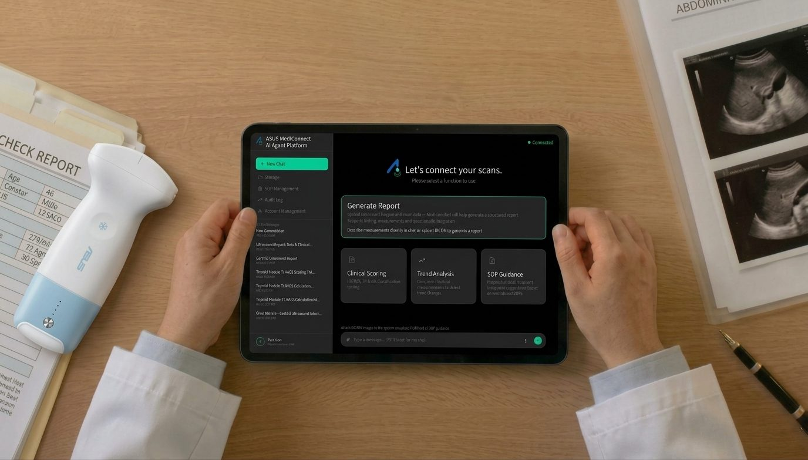

(11 月 24 日，台北訊) 華碩今宣布推出智慧醫療影像醫學流程優化平台（ASUS MediConnect AI Agent Platform），其以大型語言模型（LLM）為核心，串接超音波影像結構化紀錄與臨床工作流程，可大幅減少醫療人員謄寫報告、反覆比對量測結果等重複性行政作業，再加上 AI 輔助與病程趨勢分析，確保醫師更快掌握判讀要點及追蹤方向，提升診間效率。

_華碩今宣布推出智慧醫療影像醫學流程優化平台，其以大型語言模型（LLM）為核心，串接超音波影像結構化紀錄與臨床工作流程，可大幅減少醫療人員重複性行政作業，再加上AI輔助與病程趨勢分析，確保醫師更快掌握判讀要點及追蹤方向，提升診間效率。_

華碩電腦營運長謝明傑表示，「華碩近來持續深耕醫療 AI Agent 領域，涵蓋基礎算力、終端裝置到各種臨床應用，全新智慧醫療影像醫學流程優化平台的誕生，除了象徵華碩從終端硬體，跨入軟硬體整合的臨床協作服務嶄新里程；更是繼智慧病房後，將相關技術落地至超音波檢查的具體成果，並再次展現出華碩欲減輕醫護負擔、與醫療夥伴共同推動智慧醫療的決心！」

華碩智慧醫療影像醫學流程優化平台內建四大功能：

一、**報告生成**：將超音波影像、診前問卷、醫師口述內容等零散資料整合、排版成符合院方規範的標準化報告草稿，再由醫師修訂、確認後完成報告。

二、**臨床評估**：免去人工查找評估標準，醫師只需標出觀察到的影像特徵，系統就能自動完成量表計算，顯示對應分級與建議。

三、**趨勢分析**：可進行跨時間影像比對，將單次檢查紀錄轉化為連續的病程趨勢，協加速醫師通盤了解與監控病情。

四、**SOP 檢索**：提供自訂標準作業流程、檢查清單，並以院內規範為操作提示，即使執行人員不同也能維持檢查與判讀邏輯的一致性。

華碩智慧醫療影像醫學流程優化平台預計 12 月 22 日起正式上線，凡是華碩手持無線超音波 LU800 系列的用戶，連線訂閱後即可啟用完整功能；且平台採用地端部署架構，能將 AI 運算與病患影像資料全數保留於院內，更符合資安與隱私要求，使用安心無虞。
