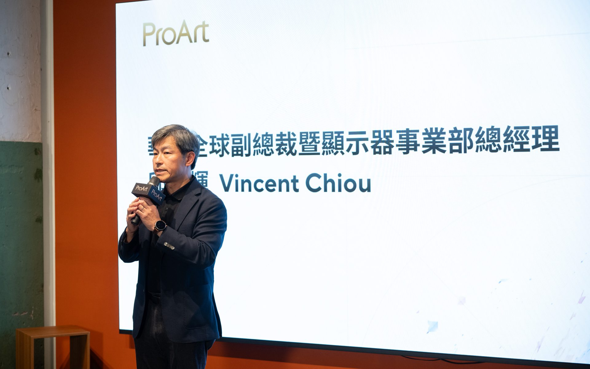
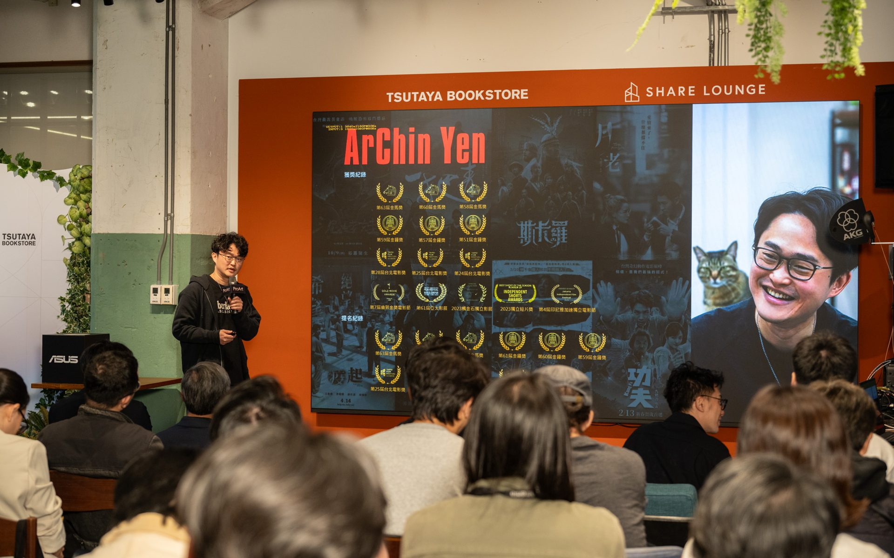
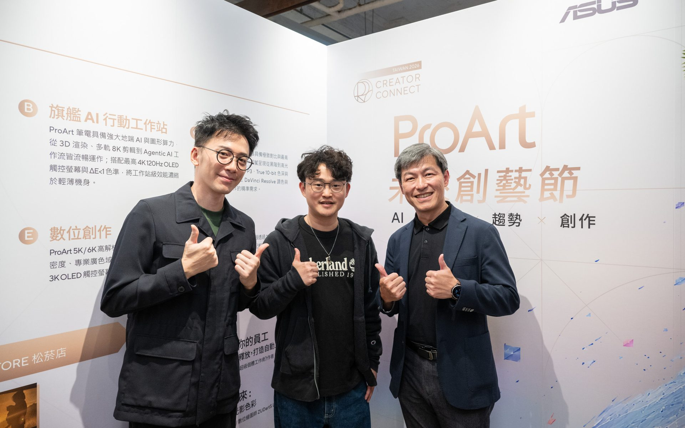

**全新4K QD-OLED專業螢幕—PA27UCDV 即日起正式在台上市！**

(11 月 26 日，台北訊) 華碩自 2024 連續兩年舉辦「ProArt 影視菁英交流會」，廣獲業界好評，今年更進一步拓展跨界合作，打造首屆「[2026 ProArt 未來創藝節](https://www.asus.com/microsite/proart_creator2026/tw/)」，即日起至 12 月 13 日將於 TSUTAYA BOOKSTORE 松菸店盛大登場！歡迎民眾呼朋引伴前來體驗結合科技、專業創作與生活的嶄新文化場域；現場拍照打卡、參加[線上心理測驗](https://ooopenlab.cc/quiz/ProArt)，還可抽 ProArt Display PA278QGV 專業螢幕(價值 NT$ 7,988 )或 ProArt 精美小禮。

華碩全球副總裁暨顯示器事業部總經理邱耀輝表示，「代理式 AI（Agentic AI）正在形塑使用者與科技互動新貌，全新 ProArt 代理人電腦與旗下多元產品，讓 AI 真正走進創作流程，它不只是工具，而是能理解需求、主動協作且值得信賴的好夥伴，並確保資訊安全、節省雲端 API Token 開銷和全時自動化代理，每位創作者都能隨心所欲演譯個人風格，實現精采創意！」

_華碩全球副總裁暨顯示器事業部總經理邱耀輝表示，全新ProArt代理人電腦與旗下多元產品，讓AI真正走進創作流程，它不只是工具，而是能理解需求、主動協作且值得信賴的好夥伴，並確保資訊安全、節省雲端API Token開銷和全時自動化代理。_

此外，活動現場除特別請來剛以電影《功夫》奪下第 63 屆金馬獎最佳視覺效果的嚴振欽總監共襄盛舉，分享 AI 浪潮下視覺特效工作流程的變革與產業趨勢，探索創作者如何在新科技時代開創新局；亦同步展出多款 ProArt 最新產品，包括：首次在台亮相，同時於即日起正式上市的 ***[4K QD-OLED 螢幕 PA27UCDV](https://www.asus.com/tw/displays-desktops/monitors/proart/proart-display-oled-pa27ucdv/)***、搭載 NVIDIA RTX Spark 超級晶片的 ***P14 / P16 行動工作站***與 ***GR1X 迷你超級電腦***，將以強悍超算力重新定義隨行 AI 創作流，共同建構從高效能運算、AI 應用到專業顯示器的完整創作生態系。

_活動現場特別請來剛以電影《功夫》奪下第63屆金馬獎最佳視覺效果的嚴振欽總監共襄盛舉，分享AI浪潮下視覺特效工作流程的變革與產業趨勢。_

_華碩全球副總裁暨顯示器事業部總經理邱耀輝與活動嘉賓共同探索創作者如何在新科技時代開創新局。_

為專業創作者而生的 ProArt Display OLED PA27UCDV，搭載 LuxPixel™ AGLR 抗眩光低反射技術，並具備 120Hz 更新率與 0.1ms GTG 反應時間，可呈現流暢細膩的視覺效果；搭配高達 1,000 nits 的峰值亮度、99% DCI-P3、100% sRGB 廣色域、真 10-bit 色深，符合 VESA DisplayHDR True Black 400 規範，還有出廠預先校色與 Calman Verified 認證，以成就 Delta E < 1 的絕佳色準，無論影像細節或色彩層次皆無懈可擊！

全新 ProArt Display OLED PA27UCDV，不僅配備雙 Thunderbolt™ 4 連接埠，能支援最高 140W 電力傳輸與 MST 多螢幕菊鏈串接，滿足新一代 AI 筆電的高功率供電需求；再加上 HDMI 2.1、DisplayPort 1.4，以及內建的 USB Hub、Auto KVM 功能和 M Model-P3 色彩模式，除適用於市面上包含 Mac 在內等多數裝置，亦可透過單組鍵盤與滑鼠快速切換兩台連接設備，使用更彈性靈活，得心應手。

**ProArt Display OLED PA27UCDV，建議售價：NT$ 29,900**，即日起至 12 月 31 日以前購買 ProArt 全系列產品並完成線上登錄，還有機會將 KODAK 拍立得口袋相機(價值 NT$ 5,990)、0 元購機優惠(最高享回饋金 NT$ 10,000)與 ProArt 靈感力香氛等超值好禮帶回家；更多詳情及最新消息請密切關注[官方活動網站](https://www.asus.com/tw/events/infoM/activity_ProArt_2026SP_giveaway)。

## 【2026 ProArt 未來創藝節】

- **活動時間：** 11 月 26 日（四）至 12 月 13 日（六）[^1]
- **活動地點：** TSUTAYA BOOKSTORE 松菸店（台北市信義區光復南路 133 號 1 樓；捷運國父紀念館站步行約 8 分鐘）
- **創藝系列講座：**

**11/30（一）【AI 如何重塑影視創作｜導演 × 技術 × 後期，三方分享】**

攜手國立臺灣藝術大學，邀集跨領域專家深度剖析 AI 如何改變影視創作流程、突破技術界線，探索科技與創意的未來平衡與全新可能。

**12/5（六）【讓 AI 成為你的員工 幫你工作、釋放時間，打造自動工作流】**

每個人都在聊 AI 代理，但你真的有好好用過嗎？讓 AI Agent 專家 aka 知名網路 YouTuber 雷蒙，用最深入淺出的方式，帶你進入全民 Agent Computer 的嶄新世代！

**12/12（六）【當個人 AI Agent 成為你的專屬製片夥伴，把時間還給創意】**

告別改不完的版本與繁瑣前置！AI 專家胡嘉璽手把手教免寫 Code 也能指揮 AI Agent 串接腳本到成片。

**12/13 日（日）【讓畫面活起來：人物與場景的光影色彩】**

知名概念設計師大飛現場示範人物肖像、場景氛圍繪製，帶你掌握光影與色彩，打造更具立體感和情境張力的匠心鉅作。

## 新聞圖片

_華碩全球副總裁暨顯示器事業部總經理邱耀輝與嘉賓合影留念為今日活動畫下完美句點。_

[^1]: 展期部分時段因包場活動將暫停對外開放，請密切注意 TSUTAYA BOOKSTORE 官方粉絲專頁公告。
