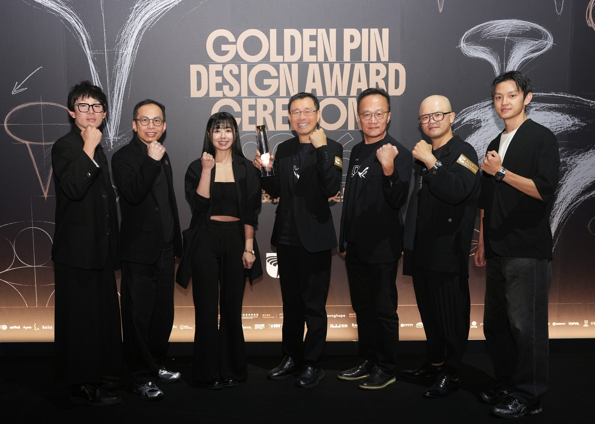

（11 月 27 日，台北訊） 華碩於 2026 年金點設計獎（Golden Pin Design Award）再創佳績，憑藉 ROG Zephyrus Duo（2026）電競筆電摘下最高殊榮「年度最佳設計獎」。本屆共有 474 件作品獲得金點設計獎標章，華碩以 21 件獲獎作品居冠，其中更有 4 件入圍年度最佳設計獎，入圍數同樣為本屆最多，展現華碩深厚的設計底蘊與持續突破的創新實力。

_華碩於2026年金點設計獎再創佳績，憑藉ROG Zephyrus Duo（2026）電競筆電摘下最高殊榮「年度最佳設計獎」。_

華碩今年獲獎產品橫跨消費性筆電、電競、專業創作、商用電腦、主機板、網通及周邊配件等多元領域。其中，ROG Zephyrus Duo（2026）電競筆電、ASUS ZenMouse、ROG G1000 電競桌機及 TUF Gaming T700 系列電競桌機共 4 件作品入圍年度最佳設計獎，數量居本屆之冠。

華碩共同執行長許先越於頒獎典禮中表示：「我們始終相信，好的產品設計必須從消費者需求與感受出發，透過不斷的技術突破與創新，解決使用者痛點。這座獎項是對團隊多年心血最溫暖的肯定，但這不是終點，我們會繼續用設計與技術的極限，帶給大家更多幸福感。」

## 華碩「年度最佳設計獎」得獎產品 – ROG Zephyrus Duo（2026）電競筆電

ROG Zephyrus Duo（GX651）電競筆電以「雙主螢幕、零妥協」為設計原則，突破傳統散熱與天線架構限制，搭載雙 16 吋 3K ROG Nebula HDR OLED 觸控螢幕，均具備 120Hz 更新率、0.2ms 反應時間、Delta E < 1 的色彩精準度、DCI-P3 100% 色域及 1100nits 峰值亮度，為遊戲玩家與內容創作者提供媲美專業顯示器的雙螢幕體驗，減少頻繁切換視窗的不便，將桌機級多工體驗融入行動裝置。

透過精密 320 度轉軸、內建支架及厚度僅 5.1mm 的可拆式無線藍牙鍵盤，ROG Zephyrus Duo 提供雙螢幕、筆電、書本、帳篷及分享等五種使用模式，靈活滿足遊戲娛樂、多工創作及協作分享等多元情境；另搭載 Intel® Core™ Ultra 9 386H 處理器及最高 NVIDIA® GeForce RTX™ 5090 筆電 GPU，結合全新散熱架構、CNC 切削鋁合金機殼與獨具風格的 Slash Lighting 玻璃燈效，實現設計美學、旗艦效能與使用彈性的高度平衡。

## 關於金點設計獎

金點設計獎創立於 1981 年，旨在表揚傑出的創新設計，鼓勵企業重視設計力與研發，提升品牌附加價值，同時為消費者與市場提供優質設計認證，創造美好生活品質。
